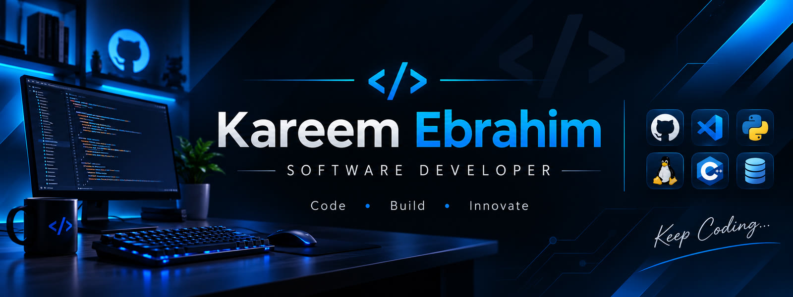

### Hi, I'm Kareem 👋

I build **developer tools, automation and AI-powered products**: software that makes the work you
already do faster, clearer and easier to see.

Every project here is open source and comes with a full guide: what it does, how to install it and
how to use it.

### Projects

| Project | What it does |
|---|---|
| [**Live Pulse**](https://github.com/kareem-ebrahim/live-pulse) | A live, full-screen dashboard of every Claude Code session on your machine: sessions, subagents, the files they edit, real diffs, commands, background shells and context, in its own terminal window. |

More projects are on the way.

### Tools I work with

